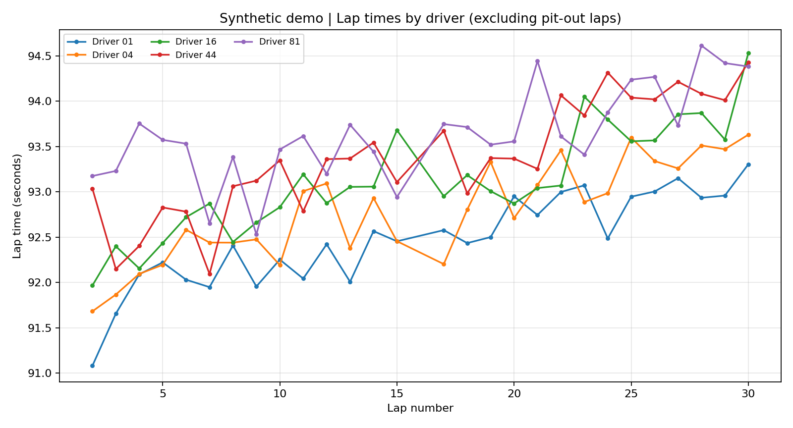
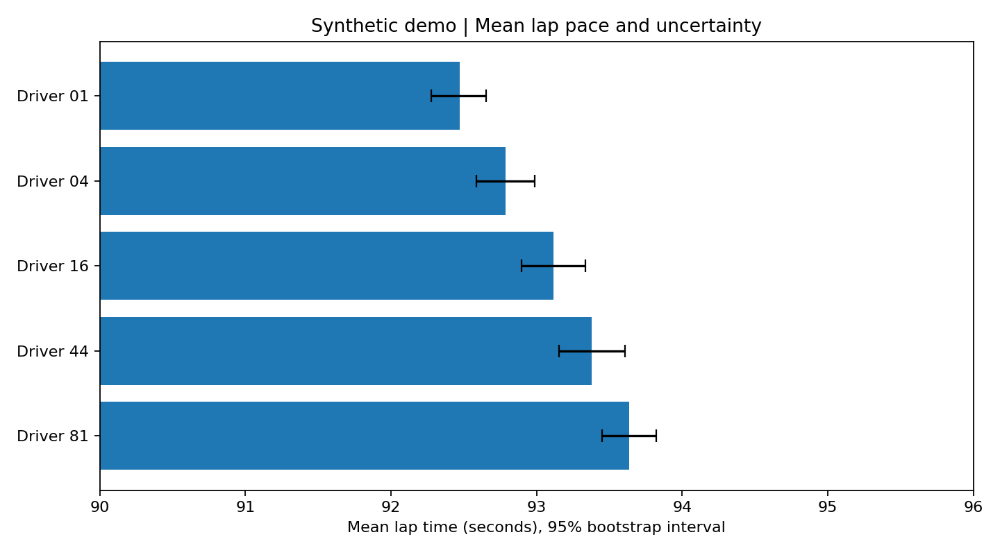

# OpenF1 Race Analytics | Python + SQL + ETL

**Portfolio project — Data Analytics / BI / Data Engineering**

> **Data transparency:** All bundled charts, statistics, CSV samples and findings are **SYNTHETIC DEMONSTRATION DATA**, not real Formula 1 timings. Real historical OpenF1 ingestion is supported through a separate opt-in command. No fabricated claims of real-world performance are made.

## Overview
An end-to-end, reproducible analytics project that extracts lap data, validates records, models relational data, runs advanced SQL queries, and creates statistical summaries and visual reports. Created to demonstrate analytical engineering skills in a public, non-sensitive domain.

### Screenshots




## Stack
Python (pandas, NumPy, matplotlib, requests), SQLite, SQL (CTEs, window functions, grouped aggregates), ETL, statistics, dimensional modeling. Includes a **proposed**, not deployed, Microsoft Fabric architecture.

## Project structure
```text
OpenF1_Data_Analytics_Portfolio/
├── README.md
├── requirements.txt
├── src/etl.py                  # demo or historical OpenF1 API -> SQLite star schema
├── src/analyze.py              # synthetic sample stats, bootstrap CI and plots
├── sql/analytics.sql           # CTE, DENSE_RANK, LAG, moving averages
├── data/demo_laps.csv         # 150 fictional observations
├── data/driver_summary.csv    # illustrative analysis results
├── data/bootstrap_ci.csv      # illustrative 95% bootstrap CIs
├── assets/*.png               # sample visualizations
├── docs/ANALYSIS.md           # findings and limitations
├── docs/ARCHITECTURE.md       # star schema, checks, optional Fabric design
├── docs/LINKEDIN_GITHUB.md    # CV/LinkedIn/GitHub copy
└── tests/test_etl.py          # transformation and database load test
```

## Quick start (offline — no API required)
```bash
python -m venv .venv
# macOS/Linux: source .venv/bin/activate
# Windows: .venv\Scripts\activate
pip install -r requirements.txt
python src/etl.py --mode demo
python src/analyze.py
pytest -q
```
Then open `data/analytics.db` using SQLite-compatible tools (such as DBeaver) and execute each statement from `sql/analytics.sql`.

## Optional: load real historical data (API access required)
```bash
python src/etl.py --mode live-api --session-key 9839 --output data/openf1_historical.db
```
The session key is an example from public documentation (2025 Abu Dhabi). Check the session and field availability before interpreting results. `src/analyze.py` and bundled plots use **demo CSV** by design; for real statistical analysis, explicitly adapt the analysis input to the newly extracted dataset. This separation prevents accidental mixing of fictional and public records.

Historical OpenF1 API: https://openf1.org/docs/ | https://openf1.org/
OpenF1 is unofficial and independent of Formula 1. Historical data is free, subject to public usage limits; this is a non-commercial educational project.

## Business questions
1. How does average/median valid lap time vary across drivers?
2. How volatile is lap pace across a session?
3. Which sectors contribute most to observed lap-time differences?
4. What is the five-lap moving average and lap-to-lap delta?

## Analysis and limitations
See [Findings](docs/ANALYSIS.md). The bootstrap demonstration does not account for lap-level serial correlation and should not be interpreted as robust real-world inference.

## Architecture
See [Architecture](docs/ARCHITECTURE.md). The Microsoft Fabric Bronze/Silver/Gold pipeline is **proposed documentation**, not a deployed artifact.

## Author
Jair da Silva Júnior — Data Analytics & Business Intelligence Portfolio
LinkedIn: https://www.linkedin.com/in/jairjunior98
GitHub: https://github.com/98nom4d
