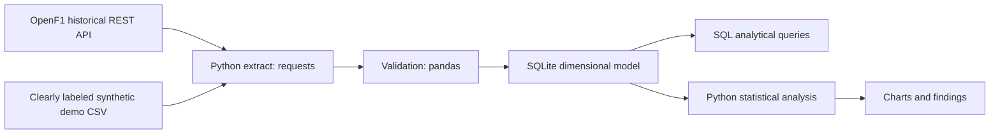

# Data architecture

## Dimensional schema
- **fact_lap** grain: one `(session_key, driver_number, lap_number)`; columns: duration, sectors, pit-out flag, valid flag.
- **dim_driver**: driver number, display name, team at selected session.
- **dim_session**: session identifier and provenance.
- Relationship: `fact_lap.driver_number -> dim_driver.driver_number`, `fact_lap.session_key -> dim_session.session_key`.
- Demo contains one session. For a multi-session model, use `(session_key, driver_number)` as the driver dimension key, because team membership may change.
- In demo, `session_key=0` and names are fictional; never mix demo records with real data.

## Quality checks
- Coerce numerical fields; drop missing primary keys; deduplicate at grain; flag pit-out and implausible laps.
- Do not automatically infer data reliability from non-null numeric values.
- Nullable sector fields are acceptable with real API data; explain exclusions in analyses.

## Microsoft Fabric extension (design only, NOT deployed)
Bronze Lakehouse: raw JSON/Parquet with ingestion timestamp and session_key.
Silver: cleaned and deduplicated Delta tables with validation checks.
Gold: lap-level fact and conformed dimensions feeding a semantic model.
Data Factory pipeline: historical incremental extract, retry/backoff, scheduled triggers and monitoring.
No Microsoft Fabric infrastructure was created or run by this package.
